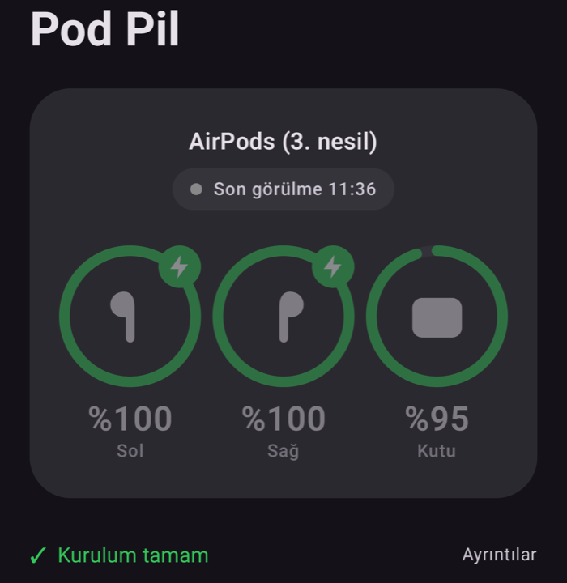

# Pod Pil

Apple AirPods'un sol kulaklık, sağ kulaklık ve kutu pil seviyelerini Android'de gösteren kişisel uygulama.
Play Store'da yok; sadece kendi telefonuma kurulmak için yazıldı. **İnternet izni yok, hiç veri kullanmaz.**



- Ana ekran: pil halkaları, şarj şimşeği, bağlantı durumu, kurulum (izin) kontrolü
- Alt pop-up: AirPods bağlanınca ekranın altından kayan kart (6 sn, kaydır/dokun ile kapanır).
  Overlay izni yoksa veya telefon kilitliyse heads-up bildirim
- Widget (Jetpack Glance): ana ekran veya kilit ekranı; bağlı değilken son değerler soluk + "son görülme"

Test edilen cihaz: Galaxy S26 Ultra (Android 17, One UI 9) + AirPods 3. nesil (A2564, yazılım 6F21).

## Gerekenler

- Android Studio (içindeki JDK kullanılıyor) ve Android SDK (`~/Library/Android/sdk`)
- `~/.zshrc` içinde:
  ```bash
  export JAVA_HOME="/Applications/Android Studio.app/Contents/jbr/Contents/Home"
  export ANDROID_HOME="$HOME/Library/Android/sdk"
  export PATH="$JAVA_HOME/bin:$ANDROID_HOME/platform-tools:$PATH"
  ```
- Gradle'ı ayrıca kurmaya gerek yok; proje kendi `gradlew` betiğini kullanır.

## Derleme

GitHub'dan indirdiysen (zip veya klon) önce `gradlew`'u çalıştırılabilir yap ve SDK yolunu bildir:

```bash
chmod +x gradlew
echo "sdk.dir=$HOME/Library/Android/sdk" > local.properties
```

Sonra:

```bash
./gradlew assembleDebug
```

APK: `app/build/outputs/apk/debug/app-debug.apk`. Birim testleri: `./gradlew testDebugUnitTest`.

## Telefona kurulum

**Kablosuz (önerilen):** Telefonda *Geliştirici seçenekleri → Kablosuz hata ayıklama* açık, telefon ve Mac aynı Wi-Fi'da.
İlk seferde *Cihazı eşleştirme koduyla eşleştir* ekranındaki adres/kod ile `adb pair <ip:port> <kod>`. Sonra:

```bash
adb connect $(adb mdns services | awk '/_adb-tls-connect/{print $3}' | tail -1)
adb install -r app/build/outputs/apk/debug/app-debug.apk
```

`adb install` takılırsa: `adb push app/build/outputs/apk/debug/app-debug.apk /data/local/tmp/p.apk` ve `adb shell pm install -r /data/local/tmp/p.apk`.

**Samsung notu:** *Otomatik Engelleyici* açıkken USB hata ayıklama çalışmaz ve kablosuz hata ayıklama zaman zaman kendiliğinden kapanır;
kapanınca tekrar açın (eşleştirme kalıcıdır, port değişir — yukarıdaki `adb connect` satırı yeni portu bulur).

## İlk açılışta telefonda

Uygulamadaki **Kurulum** bölümü eksikleri gösterir; hepsi tamamsa tek satır "✓ Kurulum tamam" görünür.

1. Bluetooth (Yakındaki cihazlar) izni
2. Bildirim izni
3. Diğer uygulamaların üzerinde göster (alt pop-up için)
4. **Pil optimizasyonu muafiyeti — zorunlu.** Bu olmadan Android, AirPods bağlandığında arka plan servisinin başlamasına izin vermez.

Widget: ana ekranda boş yere basılı tut → Widget'lar → Pod Pil.

## Nasıl çalışır

- AirPods bağlanınca (A2DP/HFP bağlantı yayını) manifest'teki `BluetoothReceiver` uyanır ve `connectedDevice` tipli
  ön plan servisi `PodService`'i başlatır. Bağlantı (ACL) kopunca veya Bluetooth kapanınca servis ve tarama **hemen** durur.
  AirPods bağlı değilken uygulama hiç çalışmaz.
- Servis, AirPods'un BLE "Proximity Pairing" reklamlarını okur (Apple üretici kimliği `0x004C`, tip `0x07`, uzunluk `0x19`);
  ayrıştırma OpenPods'un mantığıdır (`AirPodsParser.kt`, birim testleri var).
- Tarama: `SCAN_MODE_LOW_POWER`, donanım `ScanFilter` (`0x004C` + `07 19`), **toplu (batch) mod, 5 sn**.
  Yakındaki başka AirPods'ları elemek için RSSI ≥ -60 dBm ve son 10 sn'deki en güçlü cihaz; 30 sn'de en fazla 4 tarama başlatma.
- Bildirim ve widget sadece pil değeri değişince (ve bağlantı kurulup kopunca) güncellenir; widget'ın periyodik güncellemesi yok.
- Son değerler `SharedPreferences`'ta saklanır (buluta yedeklenmez).

## Bilinen sınırlamalar

- **Galaxy S26 Ultra'da `0x07` paketleri sadece toplu (batch) taramaya geliyor**; anlık (normal) taramaya hiç düşmüyor
  (10.10.2026'da ölçüldü). Tarama modu değiştirilirse değerler gelmez.
- **Hassasiyet %10.** AirPods BLE'de pili 0-10 arası yollar; uygulama aralığın ortasını gösterir (5 → %55, 10 → %100).
  iPhone'daki %1 hassasiyet bu yolla mümkün değil.
- **İlk değer gecikmesi:** bağlantıdan sonra ~5 sn (en fazla ~25 sn); pop-up bu ilk taze değeri bekler, 30 sn'de gelmezse çıkmaz.
- **Kutu pili:** kulaklıklar kutunun dışındayken kutunun pilini bilmez; son bilinen değer gösterilir. Kulaklıkları kutuya
  koyup kapağı hemen kapatırsanız son "şarj oluyor" bilgisi bağlantı kopmadan gelmeyebilir.
- **Sadece bağlıyken:** AirPods telefona bağlı değilken değer okunmaz (tasarım gereği; pil tasarrufu).
- Android, overlay pencerelerini kilit ekranında göstermez; telefon kilitliyken pop-up yerine bildirim çıkar.
  Overlay gösterilirken Android kendi "üzerinde gösteriliyor" bildirimini de ekler.
- Samsung'un pil yönetimi uygulamayı yine de uyutursa bağlantı olayları kaçabilir: *Ayarlar → Pil → Arka plan kullanım
  sınırları → Hiç uyumayan uygulamalar*'a Pod Pil'i ekleyin.
- Model adı sadece bilinen kodlar için yazılır (AirPods 1/2/3, Pro, Pro 2, Pro 3); diğerleri "AirPods (model XXXX)" görünür.
- Kod `BluetoothDevice` UUID'leri veya adında "AirPods" geçmesiyle AirPods'u tanır; Beats ürünleri test edilmedi.

## Dosyalar

| Dosya | Görev |
|---|---|
| `AirPodsParser.kt` | 27 baytlık `0x07` reklamını sol/sağ/kutu + şarj bitlerine çevirir (flip biti dahil) |
| `PodScanner.kt` | Düşük güçlü toplu BLE taraması, RSSI/en güçlü sinyal seçimi, başlatma sınırı |
| `BluetoothReceiver.kt`, `AirPodsDevice.kt` | Bağlantı/kopma yayınları, AirPods tanıma |
| `PodService.kt` | Bağlıyken çalışan ön plan servisi + kalıcı bildirim |
| `PodRepository.kt` | Tek durum kaynağı, kalıcı kayıt, widget tetikleme |
| `PodPopup.kt` | Alt pop-up (overlay) ve heads-up bildirim |
| `PodWidget.kt` | Glance widget |
| `MainActivity.kt`, `BatteryViews.kt` | Ana ekran ve ortak pil görünümü |

Referanslar: [OpenPods](https://github.com/adolfintel/OpenPods), [CAPod](https://github.com/d4rken-org/capod),
[furiousMAC/continuity](https://github.com/furiousMAC/continuity).
